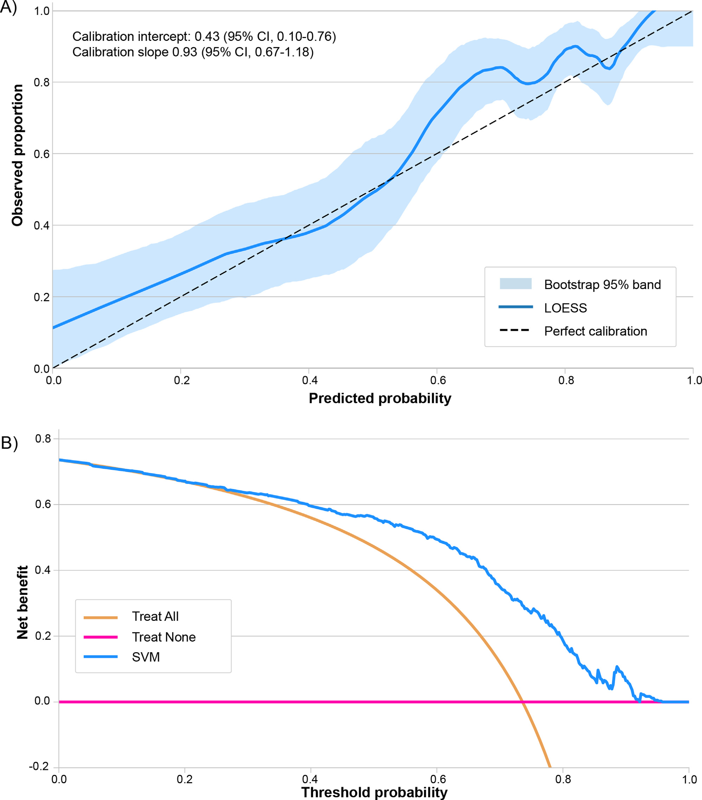
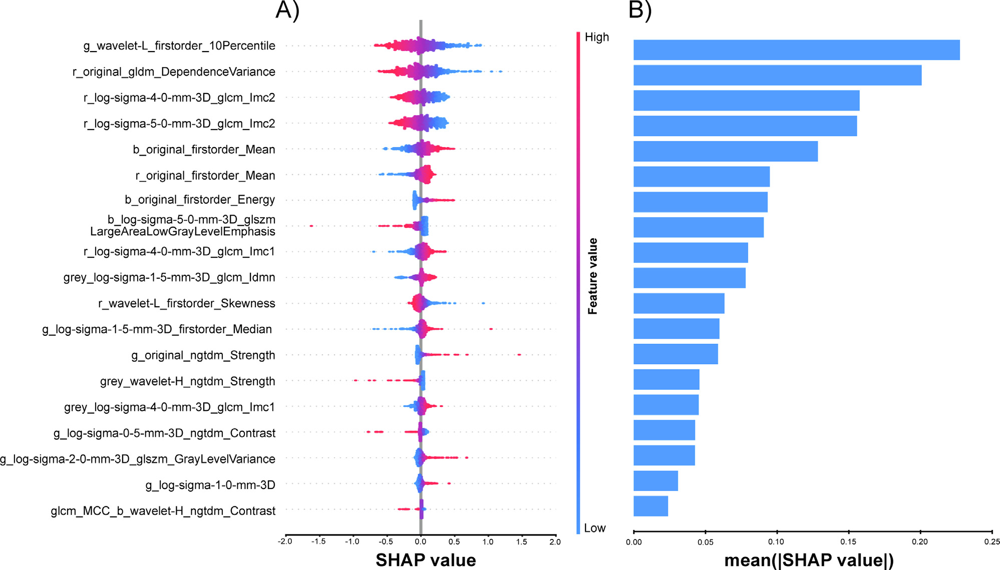
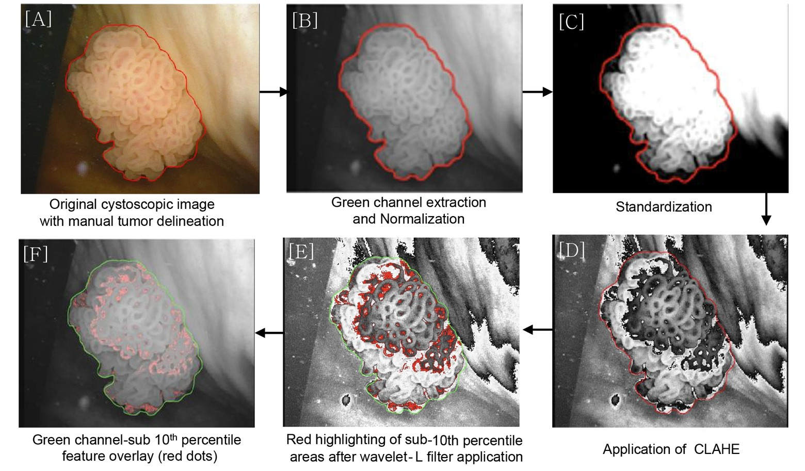

# Endoscopic Radiomics for Bladder Cancer Grading

Interpretable multichannel radiomics analysis of white-light cystoscopy images for bladder cancer grade prediction.

We extracted radiomic features from the grey, red, green and blue channels of cystoscopy images and compared five classifiers for low-grade versus high-grade bladder cancer. The support vector machine reached an AUROC of 0.87 in internal validation and 0.79 in external validation.

<p align="center">
  
</p>

## Associated Publication

Choi Y, et al. A Novel Radiomics-based Interpretable Model for Bladder Cancer Grade Prediction Using White-Light Cystoscopy Images. European Urology Open Science. 2026;87:71–79.

https://doi.org/10.1016/j.euros.2026.03.018

## Reproducibility Note

This repository provides research companion code for the published study.

Some analysis procedures differ from the original analysis code used for the manuscript. See [Differences from the original analysis code](#differences-from-the-original-analysis-code) before attempting reproduction.

## Quick Start

```bash
conda create -n endo-radiomics -c conda-forge python=3.9 llvm-openmp -y
conda activate endo-radiomics
pip install -r requirements.txt
```

Run the pipeline on synthetic data:
```bash
python scripts/make_toy_data.py
python main.py --step all --config configs/toy.yaml
```

## Data

The study images are not public. To run the code on your own data:
```
data/
├── regions.csv   # region_id, patient_id, centre, image_path, polygon, grade, age, sex
└── images/       # DICOM, PNG or JPG
```
Details: [data/README.md](data/README.md)

## Usage

```bash
python main.py --step {split,extract,select,train,evaluate,explain,all} --config configs/default.yaml
```

## Main Results

<p align="center">
  
</p>

<p align="center">
  
</p>

## Calibration and Decision Curve

<p align="center">
  
</p>

## Interpretability

<p align="center">
  
</p>

<p align="center">
  
</p>

## Differences from the original analysis code

- The original code kept the cross-validation model with the best AUROC on the internal validation cohort. This code chooses models by cross-validation on the training cohort only, so the published internal results may be optimistic.
- The original code removed internal (654 → 584) and external validation regions using an inclusion flag that the paper does not describe. The final external prediction file has 356 regions; the paper reports 358.
- The original split was stratified by tumour grade only, and cross-validation was not stratified. This code follows the paper (age, sex and grade).
- The CIs in the abstract come from a region-level bootstrap and those in Table 2 from a patient-level bootstrap. The calibration CIs are Wald intervals.
- The evaluation code and the GWL10 map were re-implemented from the paper's Methods.

## Citation

If you use this repository in academic research, please cite the associated publication.

```bibtex
@article{choi2026radiomics,
  title   = {A Novel Radiomics-based Interpretable Model for Bladder Cancer Grade Prediction Using White-Light Cystoscopy Images},
  author  = {Choi, Yewon and Cho, Sang Wouk and Hong, Junho and Lee, Jongsoo and Kim, Hwiyoung and Lee, Kwang Suk},
  journal = {European Urology Open Science},
  year    = {2026},
  volume  = {87},
  pages   = {71--79},
  doi     = {10.1016/j.euros.2026.03.018}
}
```

## Contact

Yewon Choi ([Homepage](https://yeong22.github.io), [Google Scholar](https://scholar.google.com/citations?hl=en&user=DFJ7HgkAAAAJ))

## License

Apache-2.0. Figures and tables are from the article (CC BY 4.0).
