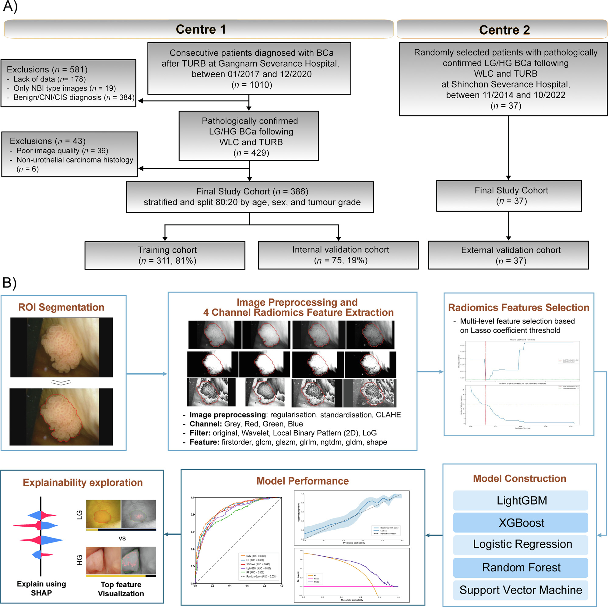
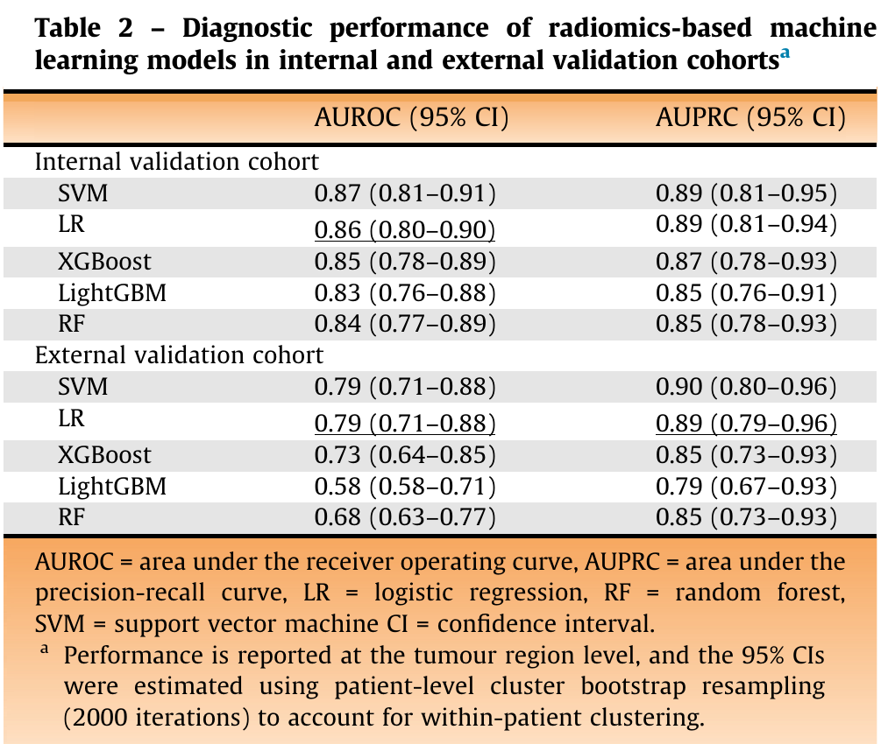
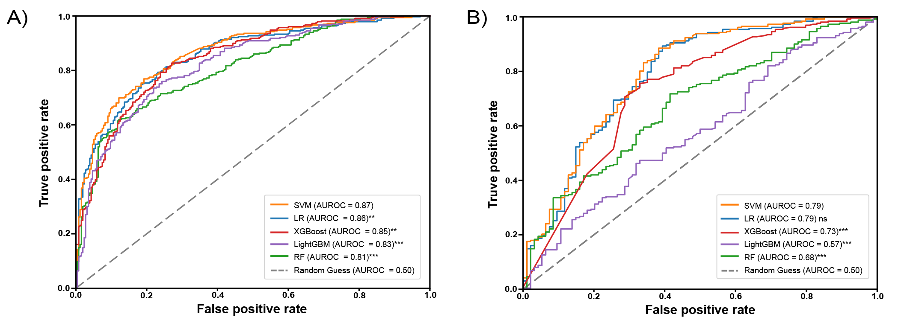

# [Eur Urol Open Sci 2026] Endoscopic Radiomics for Bladder Cancer Grading: A Novel Radiomics-based Interpretable Model for Bladder Cancer Grade Prediction Using White-Light Cystoscopy Images

<p align="center">
   📖 <a href="https://doi.org/10.1016/j.euros.2026.03.018" target="_blank">Paper</a>&nbsp;&nbsp;&nbsp;&nbsp;💾 <a href="https://doi.org/10.5281/zenodo.24502401" target="_blank">Zenodo</a>
</p>

White-light cystoscopy (WLC) is the standard diagnostic modality for bladder cancer, but preoperative grading remains inaccurate. We developed an interpretable multichannel radiomics model that predicts low-grade versus high-grade bladder cancer from WLC images. Images were collected retrospectively from **423** patients at two centres, with **2,624** tumour regions for training and **584** and **358** regions for internal and external validation. Radiomic features were extracted from the greyscale, red, green and blue channels, selected by coefficient thresholding and LASSO, and used to train five machine-learning classifiers. The support vector machine reached an AUROC of **0.87** (95% CI, 0.84–0.89) in internal validation and **0.79** (95% CI, 0.73–0.85) in external validation. SHAP analysis showed distinct radiomic patterns for low-grade and high-grade tumours, and a green-channel wavelet feature (GWL10) was the most influential feature for grade classification.

<p align="center">
   
</p>

<br>
<br>

## Quick Start

Create a new virtual environment, e.g. with conda

```bash
~$ conda create -n endo-radiomics -c conda-forge python=3.9 llvm-openmp
```

Activate the environment:
```bash
~$ conda activate endo-radiomics
```

Install the required packages:
```bash
~$ pip install -r requirements.txt
```

Prepare the data:
```bash
~$ mkdir -p ./data/images
```

Place regions.csv and the WLC images in the ./data directory (format: [data/README.md](data/README.md)). Without access to the study images, create a synthetic example in the same format:
```bash
~$ python scripts/make_toy_data.py
```

Your directory structure should look like this:
```
Endoscopic-Radiomics-for-Bladder-Cancer-Grading/
├── data/
│   ├── regions.csv
│   └── images/
│       └── ... (DICOM, PNG or JPG frames)
├── configs/
├── src/
├── main.py
├── requirements.txt
└── README.md
```

<br>

## Dataset

The study images are not public.

1) Centre 1, Gangnam Severance Hospital (2017–2020): training (311 patients, 2,624 tumour regions) and internal validation (75 patients, 584 regions)
2) Centre 2, Severance Hospital: external validation (37 patients, 358 regions)

<br>

## Training and Evaluation

```bash
~$ python main.py --step {split, extract, select, train, evaluate, explain, all} --models {lr, svm, rf, xgb, lgbm} --config configs/default.yaml
```

Run every step on the synthetic example:
```bash
~$ python main.py --step all --config configs/toy.yaml
```

Differences between this code and the original analysis code are listed in [docs/reproducibility.md](docs/reproducibility.md).

<br>

## Main Results

<p align="center">
  
  
</p>
<br>

## Calibration and Decision Curve

<p align="center">
  
</p>
<br>

## Interpretability

<p align="center">
  
  
</p>
<br>

## Cite Us
If you find this repository useful in your research, please cite our work:

```bibtex
@article{choi2026radiomics,
      title={A Novel Radiomics-based Interpretable Model for Bladder Cancer Grade Prediction Using White-Light Cystoscopy Images},
      author={Yewon Choi and Sang Wouk Cho and Junho Hong and Jongsoo Lee and Hwiyoung Kim and Kwang Suk Lee},
      journal={European Urology Open Science},
      volume={87},
      pages={71--79},
      year={2026},
      doi={10.1016/j.euros.2026.03.018}
}
```

## Contact
Yewon Choi ([Homepage](https://yeong22.github.io), [Google Scholar](https://scholar.google.com/citations?hl=en&user=DFJ7HgkAAAAJ))
